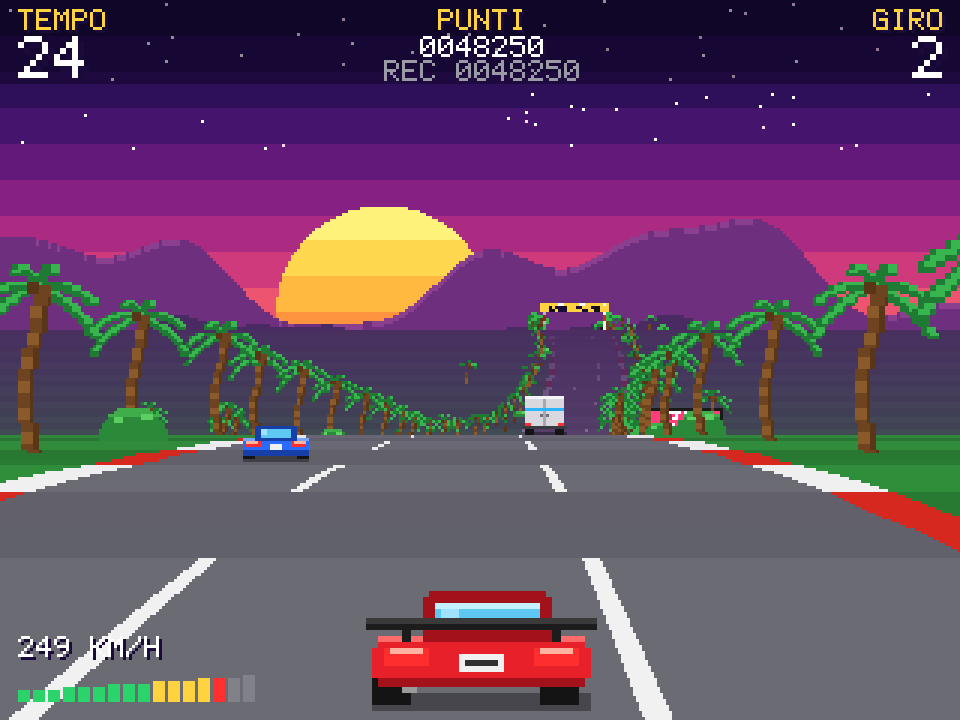

# 🏁 Retro Racer

Gioco arcade di corse automobilistiche in stile anni '80, con grafica pseudo-3D
alla *OutRun* / *Pole Position*: tramonto synthwave, palme, colline, traffico e
una corsa contro il tempo da un checkpoint all'altro.



**▶ Gioca online:** https://mceserani.github.io/retro-racer/

## Avvio rapido

Non serve installare niente:

1. scarica il repository (pulsante *Code → Download ZIP*, oppure `git clone`);
2. apri `index.html` con un doppio clic: si apre nel browser e puoi giocare.

| Tasto | Azione |
|---|---|
| ↑ / W | Accelera |
| ↓ / S | Frena |
| ← → / A D | Sterza |
| Invio / Spazio | Inizia / riprendi |
| P | Pausa |
| M | Audio on/off |
| Esc | Pausa / torna al menu |

Su tablet e smartphone si gioca toccando lo schermo (vedi il manuale).

## Documentazione

- 📘 [Manuale utente](docs/MANUALE_UTENTE.md): regole, comandi, punteggio, consigli
- 🛠️ [Documentazione tecnica](docs/DOCUMENTAZIONE_TECNICA.md): architettura, rendering pseudo-3D, fisica, come modificare il gioco

## Caratteristiche

- Rendering pseudo-3D a scanline in 320×240, ingrandito a pixel netti, con effetto monitor CRT
- Curve, salite, discese e dossi; nebbia in lontananza e sfondi in parallasse
- Traffico con semplice intelligenza artificiale che evita le altre auto
- Tempo limite con checkpoint, giri sempre più difficili, record salvato nel browser
- Grafica e suoni (Web Audio) interamente generati dal codice: nessun file esterno
- JavaScript puro, zero dipendenze, nessun passaggio di build

## Sviluppo

```bash
npm test          # esegue i test automatici (richiede Node.js 18 o superiore)
```

Per lo sviluppo basta un editor e un browser; i dettagli sono nella
[documentazione tecnica](docs/DOCUMENTAZIONE_TECNICA.md).

## Licenza

[MIT](LICENSE) © 2026 Matteo Ceserani
